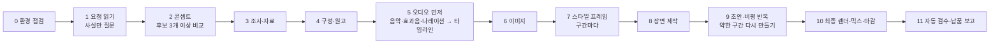

<div align="center">

# showreel

**요청 한 번으로 한국어 모션그래픽 영상을 만드는 Claude Code 스킬입니다. 콘셉트, 조사, 원고, 나레이션, 음악, 이미지, 렌더, 비평과 재작업, 믹스, 검수까지 한 번에 진행합니다.**

[English](README.md) · [한국어](README.ko.md)

[](LICENSE)
[](https://docs.claude.com/en/docs/claude-code/skills)
[](#요구-사항)
[](https://www.python.org/)
[](https://nodejs.org/)
[](https://github.com/revfactory/showreel/releases)

<a href="https://github.com/revfactory/showreel/releases/download/v1.0.0/showreel-promo-120s.mp4">
  
</a>

<sub>이 스킬로 만든 2분짜리 showreel 소개 영상의 주요 장면입니다. 소리는 아래 전체 영상에서 들을 수 있습니다.</sub>

</div>

---

> **이 포크(ynginkim/showreel)의 차이.** 배경음악은 [op55](https://github.com/ynginkim/op55) 스킬로 Claude가 코드로 작곡합니다. ElevenLabs Music은 쓰지 않고, ElevenLabs는 나레이션·받아쓰기·효과음에만 씁니다. 아래 데모는 업스트림 v1.0.0에서 ElevenLabs 음악으로 만든 것입니다.

## 데모

아래 2분 영상은 이 스킬이 요청 한 번으로 만든 결과물입니다. ElevenLabs 보이스 네 개, 생성 음악, 효과음, AI 이미지, 표현 기법 22종이 들어가고, 자동 검수를 통과했습니다. 이 데모는 v1.0.0(질문으로 방향을 정하던 이전 방식)으로 만들었습니다.

<!-- DEMO_VIDEO -->

**[▶ 전체 데모 내려받기 (1080p, 2분, 31MB)](https://github.com/revfactory/showreel/releases/download/v1.0.0/showreel-promo-120s.mp4)**

<p align="center">
  
</p>

## 목차

- [데모](#데모)
- [소개](#소개)
- [주요 기능](#주요-기능)
- [작업 순서](#작업-순서)
- [요구 사항](#요구-사항)
- [설치](#설치)
- [시작하기](#시작하기)
- [기본값](#기본값)
- [스크립트 목록](#스크립트-목록)
- [저장소 구성](#저장소-구성)
- [환경 변수](#환경-변수)
- [문제 해결](#문제-해결)
- [한계](#한계)
- [기여하기](#기여하기)
- [보안](#보안)
- [라이선스](#라이선스)
- [감사의 말](#감사의-말)

## 소개

`showreel`은 Claude Code용 [에이전트 스킬](https://docs.claude.com/en/docs/claude-code/skills)입니다. "신제품 출시 홍보 영상 60초, 웅장하게, 나레이션 넣어서"처럼 짧게 요청하면 바로 납품할 수 있는 영상과 부속 파일을 만듭니다.

- 마스터 MP4와 공유용 경량 MP4
- 포스터 JPG와 자막 SRT
- 제작노트: 출처, 설정값, 공개 전에 확인할 것, 모든 파일을 다시 만드는 명령

이 스킬은 한 요청을 기준으로 만들었습니다. *"당신이 얼마나 놀라운 모션 그래픽 디자이너인지 보여주는 역동적인 한글버전 1분 모션그래픽 비디오를 만들어 보세요. 이력서용 쇼릴 처럼요. 전력을 다해요."* 영상 자체가 만든 쪽의 실력을 증명해야 합니다. 그래서 정해 둔 무드나 템플릿이 없습니다. Claude가 콘셉트 후보를 여러 개 써서 같은 기준으로 비교하고, 구간마다 아트 디렉션(매체, 팔레트, 서체, 움직임의 성격)을 따로 정하고, 화면을 코드(DOM, 캔버스 2D, WebGL 셰이더, three.js)로 만든 뒤, 초안마다 비평을 남기고 가장 약한 구간을 다시 만듭니다.

한국어 콘텐츠를 기준으로 썼습니다. 한글 타이포그래피, 한국어 나레이션, 발음 표기 규칙이 들어 있습니다. 엔진, 렌더러, 오디오 도구는 언어와 관계없이 쓸 수 있습니다.

## 주요 기능

| 단계 | 하는 일 |
| --- | --- |
| **요청 읽기·콘셉트** | 사용자만 아는 사실(대상, 꼭 넣을 정보, 자료 위치)만 묻습니다. 무드·길이·화면비·나레이션·이미지는 Claude가 정합니다. 콘셉트 후보를 3개 이상 써서 같은 기준으로 비교하고, 고른 콘셉트와 구간별 아트 디렉션을 `concept.md`에 남깁니다. |
| **조사** | 조사를 서브에이전트에 백그라운드로 맡깁니다. 영상에 넣는 사실마다 출처 URL과 확실도를 적고, 날짜는 달력과 대조해 요일을 확인합니다. |
| **원고** | 나레이션을 넣을 때는 화면 표기와 발음 표기를 나눠 쓰고 분량을 길이에 맞춥니다(60초에 공백 제외 220~255자). 장면 전환에 맞출 단어에 큐 이름을 붙입니다. |
| **나레이션** | 요청에 있거나 내용상 필요할 때만 넣습니다. ElevenLabs TTS로 만들고, 보이스는 콘셉트에 맞춰 고릅니다(낭독 설정을 검증해 둔 보이스: Marcus, 깊은 바리톤). 줄마다 테이크를 여러 개 만들 수 있고, 바뀐 줄만 다시 생성하며, 받아쓰기(STT)로 모든 줄의 발음을 확인합니다. |
| **음악·효과음** | 음악은 [op55](https://github.com/ynginkim/op55) 스킬로 Claude가 작곡합니다. 악보(`score.mjs`)를 쓰고, 합성 악기와 사운드폰트 샘플로 결정적으로 렌더하고, 음량·격자·에너지를 숫자로 검증합니다. op55가 쓴 `analysis.json`(악보에서 계산한 정확한 박 격자)을 그대로 타임라인에 씁니다. ElevenLabs Music은 쓰지 않습니다. 효과음은 ElevenLabs 효과음 API나 NumPy 합성기로 만들고, 프리셋은 24종입니다. |
| **이미지** | 이미지가 필요한 장면만 [codex-image](https://github.com/revfactory/skills)로 생성합니다. 레터박스 제거, 확대, macOS Vision 누끼를 처리합니다. 실존 인물은 생성하지 않습니다. |
| **모션 엔진** | 결정적인 HTML/JS 타임라인(`REEL`)입니다. 모든 프레임이 시간 t만으로 정해지므로 여러 워커가 프레임 순서와 관계없이 나눠 렌더할 수 있습니다. |
| **표현 기법** | 검증된 기법 코드 22종(한글 자모 조립, 가변 굵기 물결, 유리 활자, 입자 글자, 매치 컷 등)과 WebGL2 셰이더, three.js 3D, 미리 계산하는 시뮬레이션을 제공합니다. 기법 목록에서 고르는 것이 아니라 콘셉트에서 출발해 필요한 코드를 가져다 씁니다. |
| **렌더** | Playwright와 시스템 Chrome으로 렌더합니다. 서브프레임 모션 블러(셔터 180°)를 넣고, 중단돼도 이어서 렌더하며, BT.709 `yuv420p` TV 범위로 출력합니다. |
| **믹스·마스터링** | 음악의 말소리 대역을 나레이션 아래에서 깊게 줄입니다. 줄마다 "나레이션 대 배경" dB를 보고하고, 2패스 loudnorm으로 -14 LUFS에 맞춥니다. |
| **비평 반복** | 초안마다 질문 여덟 개(템플릿과 구분되는가, 구간끼리 다른 작업으로 보이는가, 구간마다 "어떻게 만들었지" 싶은 순간이 있는가, 한글을 재료로 썼는가, 프레임 띠에서 무게가 보이는가, 리듬, 다음 구간이 예상되는가, 가장 약한 구간)로 구간마다 유지·고침·다시 만듦을 판정하고 `qa/critique_NN.md`에 남깁니다. |
| **자동 검수** | 규격, 음량, 너무 어두운 구간, 광과민성 섬광, 멈춘 화면, 움직임 부족을 검사하고 완성 믹스를 받아써서 `qa/qa_report.md`에 기록합니다. |

## 작업 순서



오디오를 화면보다 먼저 만듭니다. `timeline.py`가 나레이션 단어 시각과 음악 히트를 이름 붙은 큐로 바꾸고, 장면 코드는 초 단위 숫자 대신 `REEL.cue('이름')`으로 그 큐를 읽습니다. 그래서 나레이션 한 줄을 다시 만들어도 화면을 고칠 필요가 없습니다.

오래 걸리는 작업(조사, TTS, 음악, 이미지 생성, 최종 렌더)은 백그라운드로 돌리고, 그동안 Claude는 다음 단계를 진행합니다.

## 요구 사항

| 도구 | 필수 여부 | 용도 |
| --- | --- | --- |
| [Claude Code](https://docs.claude.com/en/docs/claude-code/overview) | 필수 | 스킬 실행 |
| macOS | 권장 | 개발·검증한 환경입니다. Linux에서도 `REEL_CHROME_PATH`를 지정하면 렌더와 오디오 처리는 됩니다. 누끼는 macOS에서만 됩니다 |
| Python 3.10 이상, `numpy`, `Pillow` | 필수 | 타임라인, 믹스, 검수, 이미지 후처리, 합성기 |
| Node.js 20 이상 | 필수 | 렌더러(`playwright-core`), op55 음악 렌더 |
| [op55](https://github.com/ynginkim/op55) 스킬과 사운드뱅크(88MB) | 음악에 필요 | 배경음악 작곡·렌더·검증. 음악 API 키는 필요 없습니다 |
| Google Chrome 또는 Chromium | 필수 | 헤드리스 렌더. 브라우저를 따로 내려받지 않습니다 |
| ffmpeg(`loudnorm`, `ebur128`, `freezedetect`, `signalstats`, `tmix` 필터 포함) | 필수 | 인코딩, 음량 측정, 검수 |
| [ElevenLabs](https://elevenlabs.io) API 키 | 나레이션에 필요 | TTS, 받아쓰기 검증, 효과음. 음악에는 쓰지 않습니다. Free 플랜에서는 Marcus 같은 라이브러리 보이스를 쓸 수 없습니다 |
| [Codex CLI](https://github.com/openai/codex)와 [codex-image](https://github.com/revfactory/skills) 스킬 | 선택 | AI 이미지 생성. 없으면 타이포그래피, 그래픽, 사용자 사진으로 구성합니다 |
| [photoreal](https://github.com/revfactory/skills) 스킬 | 선택 | 사람이 나오는 사진풍 이미지의 프롬프트 설계 |
| Xcode 명령줄 도구(`swiftc`) | 선택 | macOS Vision으로 인물 누끼 |

한글 폰트(Pretendard와 Google Fonts 서체, 모두 SIL OFL)는 `new_project.py`가 프로젝트마다 시스템에서 복사하거나 내려받습니다. 이 저장소에는 폰트 파일이 들어 있지 않습니다.

## 설치

**1. Claude Code 스킬 폴더에 내려받기**

```bash
# 개인 스킬: 모든 프로젝트에서 쓸 수 있습니다
git clone https://github.com/ynginkim/showreel.git ~/.claude/skills/showreel

# 프로젝트 스킬: 저장소를 통해 팀과 함께 씁니다
git clone https://github.com/ynginkim/showreel.git .claude/skills/showreel
```

**2. 의존성 설치**

```bash
brew install ffmpeg node
python3 -m pip install numpy pillow
cd ~/.claude/skills/showreel/scripts && npm install
```

**3. op55 설치**(배경음악)

```bash
npx skills add ynginkim/op55 -a claude-code          # 모든 프로젝트에 쓰려면 -g
node <op55 스킬 폴더>/scripts/setup.mjs               # 사운드뱅크(88MB)를 ~/.cache/op55에 받습니다
```

`preflight.py`는 op55를 `$OP55_SCRIPTS`, showreel 옆 폴더, 작업 폴더 위쪽의 `.claude/skills`·`.agents/skills`, `~/.claude/skills` 순서로 찾고, 찾은 경로와 사운드뱅크 유무를 보여 줍니다.

**4. ElevenLabs API 키 설정**(나레이션을 넣을 때 필요)

```bash
echo 'export ELEVENLABS_API_KEY="sk_..."' >> ~/.zshrc && source ~/.zshrc
```

프로젝트 폴더의 `.env` 파일에 `ELEVENLABS_API_KEY=sk_...` 한 줄을 적어도 됩니다.

**5. 환경 점검**

```bash
python3 ~/.claude/skills/showreel/scripts/preflight.py
```

도구마다 ✓ 또는 ✗를 표시하고, 없는 도구의 설치 명령을 알려 줍니다. 나레이션, 음악(op55), 이미지 생성 가운데 지금 쓸 수 있는 것도 함께 보여 줍니다.

## 시작하기

빈 폴더에서 Claude Code를 열고 만들고 싶은 영상을 설명합니다. "쇼릴", "모션그래픽", "홍보 영상", "티저", "60초 영상" 같은 요청이나 `/showreel` 입력으로 스킬이 실행됩니다.

```text
당신이 얼마나 놀라운 모션 그래픽 디자이너인지 보여주는 역동적인 한글버전 1분 모션그래픽 비디오를 만들어 보세요. 이력서용 쇼릴 처럼요. 전력을 다해요.
```

```text
/showreel 우리 팀이 만든 사내 검색 서비스 소개 60초 영상. 웅장한 분위기, 나레이션 넣어 줘.
```

```text
신제품 티저 30초. 테크 키노트 느낌으로, 나레이션 없이 음악과 타이포그래피만.
```

Claude는 조사로 알 수 없는 사실(예: 행사의 정확한 일시)만 묻고, 콘셉트는 스스로 정해 한두 줄로 알린 뒤 확인을 기다리지 않고 납품까지 진행합니다. 위의 쇼릴 요청처럼 Claude 자신이 대상이면 아무것도 묻지 않습니다.

완성된 프로젝트 폴더는 다음과 같습니다.

```text
my-promo/
├── concept.md, storyboard.md, script.json, timeline.json
├── research/        research.md(출처가 달린 사실), photos.md
├── audio/           vo/(나레이션 테이크), music/, sfx/, mix.wav
├── assets/          gen/(생성 이미지), img/(후처리)
├── reel/            index.html, engine.js, fx.js, timeline.js, scenes.js, fonts/
├── qa/              스틸, 검수 시트, critique_NN.md, qa_report.md
├── out/             <제목>.mp4, <제목>_공유용.mp4, 포스터, .srt
└── 제작노트.md
```

## 기본값

따로 정하지 않은 항목은 아래 값으로 만듭니다.

| 항목 | 기본값 |
| --- | --- |
| 길이·규격 | 60초, 16:9, 1920×1080, 30fps(15초·30초·60초·100초·5분, 9:16 세로 지원) |
| 분위기·아트 디렉션 | 기본값이 없습니다. 프로젝트와 구간마다 `concept.md`에서 정합니다 |
| 나레이션 | 요청에 있거나 필요할 때만. 보이스는 콘셉트에 맞춰 고릅니다. 낭독 설정을 검증해 둔 보이스는 ElevenLabs Marcus `ibCGc01503OQd2R6i1n1`, `eleven_multilingual_v2`, stability 0.45 · similarity 0.8 · style 0.4. 목소리에 리버브를 넣지 않습니다 |
| 음악 | op55로 작곡(합성 악기 + 사운드폰트 샘플). ElevenLabs Music은 쓰지 않습니다 |
| 이미지 | 필요한 장면만 생성. 실존 인물은 실제 사진만 사용 |
| 음량 | 통합 음량 -14 LUFS. `mix.py`가 true peak -2.0 dBTP로 마스터링하고, 검수 기준은 -1.0 dBTP 이하입니다 |
| 산출물 | 마스터 MP4, 공유용 MP4, 포스터 JPG, SRT(나레이션이 있을 때), 제작노트 |

## 스크립트 목록

스크립트는 모두 `scripts/`에 있습니다. Claude가 알아서 실행하므로, 아래 표는 직접 다시 실행할 때 참고하면 됩니다.

| 스크립트 | 하는 일 |
| --- | --- |
| `preflight.py` | 도구, 키, 보이스, 요금제, 남은 크레딧, op55와 사운드뱅크를 점검하고 설치 방법을 출력합니다 |
| `new_project.py` | 프로젝트 폴더, 엔진 템플릿, 폰트, 렌더러 의존성을 준비합니다. `--fonts`로 Google Fonts 서체를 더합니다 |
| `narrate.py` | `script.json`에서 바뀐 줄만 나레이션을 만듭니다. `--stt`로 발음을 검증합니다 |
| `eleven.py` | ElevenLabs 클라이언트(TTS, STT, Music, 효과음, 보이스 목록). `curl`로 호출하고, 오류 응답이 음원 파일로 저장되는 것을 막습니다 |
| `music_tools.py` | 업스트림의 ElevenLabs 음악 도구(구성 플랜, 템포·히트 분석, 구간 이어 붙이기). 기본 경로에서는 쓰지 않습니다. op55 곡의 박을 `analyze`로 다시 읽으면 곡 끝으로 갈수록 어긋납니다 |
| `synth_music.py` | NumPy로 효과음(과 업스트림의 대체 음악)을 합성합니다. 이 포크의 기본 경로에서는 효과음에만 씁니다 |
| `timeline.py` | `timeline.json`과 `reel/timeline.js`(큐, 단어 시각, 음량 곡선)를 만들고 겹침과 큐 누락을 알려 줍니다 |
| `prep_images.py` | 레터박스 제거, 확대, 누끼, 확인용 시트 |
| `codex_ref_image.sh` | 참조 사진을 붙여 이미지를 생성합니다 |
| `render.mjs` | 결정적 프레임 렌더러: 스틸, 초안, 모션 블러를 넣은 최종본, 미리보기 서버 |
| `contact_sheet.py` | 스틸이나 영상으로 검수 시트를 만듭니다. 컷 앞뒤 프레임도 볼 수 있습니다 |
| `motion_check.py` | 길이별 기준으로 멈춘 구간과 움직임이 부족한 구간을 알려 줍니다 |
| `mix.py` | 나레이션 처리, 덕킹, 효과음 배치, 마스터링. 줄마다 나레이션 대 배경 dB를 보고합니다 |
| `finish.py` | 영상과 오디오를 합치고 공유용 파일, 포스터, SRT를 만듭니다 |
| `qa_check.py` | 완성본을 자동 검수하고 `qa/qa_report.md`를 씁니다 |

음악 렌더와 검증은 op55의 `render.mjs`, `verify.py`가 맡습니다(`SKILL.md` 5단계).

## 저장소 구성

```text
showreel/
├── SKILL.md             Claude가 읽는 스킬 본문(작업 순서, 기본값, 규칙)
├── references/          단계마다 읽는 상세 문서
│   ├── brief.md         물을 것과 묻지 않을 것, 콘셉트 후보와 concept.md 양식, 조사 요청, 시간·크레딧 추정
│   ├── story.md         용도·길이별 구성, 카피와 발음 표기 규칙
│   ├── audio.md         보이스, ElevenLabs 플랜, 음악(op55 연결), 효과음, 믹스 기준
│   ├── images.md        이미지 생성, 실제 사진, 누끼
│   ├── design.md        아트 디렉션 정하기, 뻔한 화면, 움직임 원칙, 리듬, 한글 타이포그래피
│   ├── engine.md        엔진 API, 장면 작성법, WebGL·3D, 나눠 만들기
│   ├── techniques.md    표현 기법 22종과 코드
│   └── qa.md            비평, 검수 점검표, 납품 보고 양식
├── scripts/             위 표의 Python·Node·셸 도구
├── assets/
│   ├── engine/          engine.js, fx.js, index.html, scenes.js(API 사용 예시, 프로젝트에는 _example_scenes.js 로 복사)
│   └── sfx_presets.json 효과음 프롬프트 프리셋
├── evals/evals.json     스킬을 개발할 때 쓴 평가 프롬프트와 판정 기준
└── docs/media/          README용 이미지
```

## 환경 변수

| 변수 | 설명 |
| --- | --- |
| `ELEVENLABS_API_KEY` | ElevenLabs 키. 환경 변수나 프로젝트 폴더의 `.env`에서 읽습니다 |
| `REEL_CHROME_PATH` | Chrome이 기본 위치에 없을 때 Chrome 또는 Chromium 실행 파일 경로 |
| `REEL_CHROME_CHANNEL` | Playwright 브라우저 채널(기본값 `chrome`) |
| `OP55_SCRIPTS` | op55 스킬의 `scripts` 폴더. 기본 위치에서 찾지 못할 때 지정합니다 |

## 문제 해결

| 증상 | 해결 |
| --- | --- |
| 나레이션이 목표 길이를 넘김 | 원고를 줄입니다(60초 = 255자 이하). 속도는 1.05까지만 올립니다 |
| 이름이나 숫자를 잘못 읽음 | 발음 표기를 고치고, 숫자를 쉼표로 끊고, `takes`를 3~5로 늘리거나 그 줄만 `eleven_v3`로 바꿉니다 |
| 완성 믹스에서 말이 묻힘 | 타격음을 핵심 단어에서 0.2~0.3초 비키고, 그 줄의 `gain_db`를 2~3 올리거나 `--duck 0.8`을 씁니다 |
| 나레이션에 에코가 많음 | `--hall` 없이 다시 믹스합니다(`mix.py` → `finish.py`, 영상 재렌더 불필요). 리버브를 남기려면 "말 끝 잔향"이 ✓가 될 때까지 `--hall`을 낮춥니다 |
| 영상이 멈춰 보임 | `motion_check.py`가 알려 준 시각이 의도한 정지인지 확인하고, 아니면 새 사건(등장·재배치·카메라 이동)을 넣고 퇴장을 다음 구도로 이어지는 움직임으로 바꿉니다 |
| 글꼴이 기본 고딕으로 나옴 | 렌더 로그의 폰트 줄과 `reel/fonts/fonts.css`의 굵기를 확인합니다 |
| `preflight.py`의 BGM 스킬(op55)이 ✗ | `npx skills add ynginkim/op55 -a claude-code`로 설치하고 `node <op55>/scripts/setup.mjs`로 사운드뱅크를 받습니다. 다른 곳에 있으면 `OP55_SCRIPTS`를 지정합니다 |
| 음악 박과 화면 박이 어긋남 | `timeline.py`에 op55 `render.mjs`가 쓴 `analysis.json`을 줬는지 확인합니다. `music_tools.py analyze`로 다시 읽은 박은 쓰지 않습니다 |

다른 사례는 `SKILL.md`와 `references/`의 각 문서에 있습니다.

## 한계

- **Claude는 소리를 들을 수 없습니다.** 음량, 나레이션 대 배경 비율, 잔향, 받아쓰기 결과를 수치로만 확인합니다. 공개하기 전에 직접 들어 보시길 권합니다.
- 한국어 나레이션과 한글 타이포그래피를 기준으로 만들었습니다. 다른 언어로 만들려면 원고 규칙과 발음 규칙을 새로 써야 합니다.
- ElevenLabs를 쓰면 크레딧이 듭니다. 상업적 이용 조건은 쓰고 있는 ElevenLabs 플랜을 따릅니다.
- 실존 인물의 얼굴과 몸은 생성하지 않습니다. 사용 허락을 받은 실제 사진을 씁니다.
- macOS에서 개발하고 검증했습니다. 누끼는 macOS Vision을 씁니다.

## 기여하기

기여를 환영합니다. 개발 환경, `evals/`의 평가 프롬프트, PR 점검 항목은 [CONTRIBUTING.md](CONTRIBUTING.md)에 있습니다. 이 프로젝트는 [행동 강령](CODE_OF_CONDUCT.md)을 따릅니다.

## 보안

API 키, `.env` 파일, 공개할 권리가 없는 나레이션 파일은 커밋하지 마세요. 취약점은 [SECURITY.md](SECURITY.md)의 절차로 알려 주세요.

## 라이선스

[MIT 라이선스](LICENSE)로 배포합니다.

`docs/media/`의 이미지와 데모 영상은 이 스킬로 만들었습니다. 데모에는 제작자가 이전에 만든 쇼릴의 프레임, ElevenLabs 보이스와 음악, AI 생성 이미지가 들어 있습니다. 극장 장면의 관객은 AI가 만든 가상 인물이며 얼굴이 보이지 않습니다.

## 감사의 말

- [Playwright](https://playwright.dev/): 헤드리스 Chrome 제어
- [op55](https://github.com/ynginkim/op55): 배경음악 작곡·렌더·검증
- [ElevenLabs](https://elevenlabs.io): TTS, STT, 효과음 API(업스트림 데모의 음악 포함)
- [Pretendard](https://github.com/orioncactus/pretendard)와 [Google Fonts](https://fonts.google.com/)(Noto Serif KR, Black Han Sans, Anton, JetBrains Mono): 모두 SIL Open Font License
- [FFmpeg](https://ffmpeg.org/): 인코딩과 음량 측정

`showreel`은 개인 프로젝트이며 Anthropic, ElevenLabs, OpenAI와 제휴하거나 보증받지 않았습니다.
